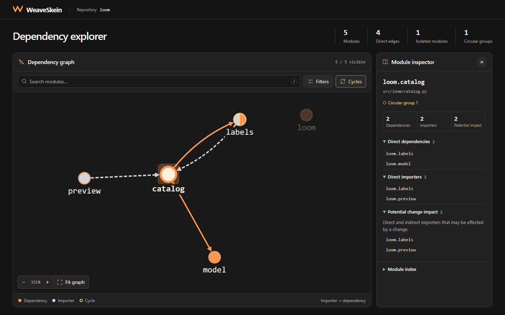

# WeaveSkein

**Untangle your codebase.**

An offline, interactive dependency explorer for Python projects.

WeaveSkein scans a local repository, analyzes its imports with Python's AST, and generates a standalone HTML graph. Explore module relationships, find circular dependencies, and see which importers could be affected by a change.



## Features

- Discover Python modules in traditional packages, namespace directories and common `src/` layouts.
- Analyze absolute, relative and nested imports without executing project code.
- Distinguish internal imports, standard-library imports, external imports and unresolved references.
- Inspect direct dependencies, direct importers and transitive potential change impact.
- Detect circular groups using strongly connected components.
- Search the graph, filter tests and examples, and focus on a selected module's direct relationships.
- Open reports directly in a browser with all JavaScript and CSS embedded.

Scanning and viewing reports work locally. No server, account, API key or database is required.

## Installation

Requires **Python 3.12 or newer** and a modern browser for interactive reports.

Clone the repository and create a virtual environment:

```sh
git clone https://github.com/Nvenno/WeaveSkein.git
cd WeaveSkein
python -m venv .venv
```

Activate it on Windows PowerShell:

```powershell
.\.venv\Scripts\Activate.ps1
```

Or on macOS and Linux:

```sh
source .venv/bin/activate
```

Install from the checkout:

```sh
python -m pip install -e .
```

Installation needs access to the Python dependencies or a prepared local wheelhouse. Normal execution and exported reports work offline.

## Quick start

Analyze your current directory and create a report:

```sh
weaveskein scan .
weaveskein cycles .
weaveskein export . --output report.html
```

Open `report.html` directly in your browser.

To explore the included example:

```sh
weaveskein scan examples/loom
weaveskein cycles examples/loom
weaveskein export examples/loom --output loom.html
```

The example contains five modules, four direct dependency edges and one circular group:

```text
Modules: 5
Direct dependencies: 4
Isolated modules: 1
Circular groups: 1
```

The cycle report identifies:

```text
Group 1: loom.catalog, loom.labels
```

## CLI reference

| Command | Purpose |
| --- | --- |
| `weaveskein scan [PROJECT]` | Show module and edge counts, isolates, circular groups, import categories and highly connected modules. |
| `weaveskein cycles [PROJECT]` | List circular dependency groups. |
| `weaveskein export [PROJECT] --output FILE.html` | Generate a self-contained interactive report. |
| `weaveskein --help` | Show command help. |

`PROJECT` defaults to the current directory. Export defaults to `report.html` and also accepts `-o`. Each command supports `--help`, and `python -m weaveskein` provides the same interface.

The output directory must exist. Export replaces an existing HTML file at the specified destination. Invalid input and export failures return a nonzero exit status. Per-file analysis problems produce warnings while analysis continues.

## Explore a report

**Navigate.** Drag the canvas to pan, drag individual nodes to reposition them, and use the mouse wheel or zoom controls to change scale. **Fit graph** frames the visible modules. Labels are shortened where needed; hovering and the inspector reveal full names.

**Search.** Press `/` to focus the search field. Search matches visible modules. Enter selects the first result, and Down Arrow moves to the results. The module index offers another keyboard-accessible way to select modules.

**Read the arrows.** Every edge points from an importing module to its dependency. For a selected module, solid orange arrows identify its direct dependencies and dashed silver arrows identify its direct importers. Gold rings mark modules in circular groups.

**Filter by path.** Open **Filters** to hide modules under `test/`, `tests/` or `__tests__/`, and under `example/`, `examples/` or `samples/`. Categories use directory components in the source path.

**Focus on a module.** After selecting a node, choose **Direct dependencies**, **Direct importers** or **All direct connections**. **Reset filters** restores the full graph. Filters affect the view. Overview statistics and inspector counts describe the complete analyzed graph.

**Inspect change impact.** The inspector shows the full name, relative path, dependency counts, cycle status and clickable related modules. Expand **Potential change impact** to see all direct and indirect importers reachable through incoming edges. These modules may be affected by a change; actual effects depend on the changed code and runtime behavior.

**Inspect cycles.** The **Cycles** button highlights cyclic modules and edges within their groups. A circular group contains mutually reachable modules. The order of names in a group does not describe a particular cycle path.

## Analysis model and limitations

Each graph node represents a discovered Python source module. Each edge represents an explicit import dependency. Repeated imports between two modules share one edge. Namespace prefixes without source files have no graph node.

- Dynamic imports, custom import hooks, generated modules and runtime changes to `sys.path` are outside the static model.
- Conditional imports, `TYPE_CHECKING` imports and imports inside functions all contribute syntactic dependencies. A circular group can occur in a program that runs successfully.
- Re-exports, star imports and package attributes can make resolution ambiguous. Ambiguous local references produce warnings and may be omitted from the graph.
- Unknown absolute top-level names are classified as external. The analyzer does not check whether third-party packages are installed.
- Implicit execution of parent package initializers is outside the graph.
- Discovery handles a selected repository root and its conventional top-level `src/` tree. Analyze monorepo subprojects separately when they use different import roots.
- Hidden directories, common cache and build directories, symlinks and Windows directory junctions are skipped.
- Syntax unsupported by the running interpreter, invalid encodings and unreadable files produce warnings and can leave outgoing relationships incomplete.

Reports include module names, paths, graph relationships and diagnostics. Review them before sharing information about a private repository.

## Development

Install the development dependencies in your virtual environment:

```sh
python -m pip install -e ".[dev]"
python -m pytest
python -m ruff check .
python -m ruff format --check .
python -m build
```

The project uses a `src/` package layout, Typer for the CLI, Python's `ast` for parsing, NetworkX for graph analysis and a locally bundled Cytoscape.js build for visualization.

For UI changes, export a report and test it directly through `file://` with networking disabled. Exercise selection, search, filters, focus modes, zoom and empty states.

## Contributing

Issues and pull requests are welcome. Include a minimal reproducible Python project, the command you ran, your Python version and the expected result. Add regression tests when changing analysis behavior and run the checks above before submitting a pull request.

## License

WeaveSkein is released under the [MIT License](LICENSE).

The report bundles Cytoscape.js 3.34.1, which has its own [MIT license and copyright notice](src/weaveskein/assets/CYTOSCAPE-LICENSE.txt). Keep these notices with redistributed copies of the bundled library.

